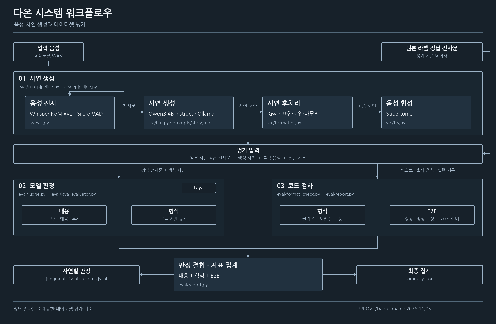

# Daon_v2

독거노인 커뮤니티용 음성 사연 생성·평가 프로젝트.



데이터셋 평가에서는 원본 라벨 정답 전사문과 생성 사연을 Laya에 함께 입력해 비교한다. 형식은 Laya와 코드 검사로 판정하고, E2E는 실제 실행 기록과 출력 음성으로 확인한다. 정답 전사문이 없는 실사용 환경에서 같은 방식의 내용 평가는 지원하지 않는다.

## 구성

| 경로 | 역할 |
|---|---|
| `src/` | STT·사연 생성·Kiwi 후처리·TTS·파이프라인 |
| `eval/` | 데이터셋 실행·Laya 판정·코드 검사·결과 집계 |
| `config/config.yaml` | 모델·장치·프롬프트·평가 설정 |
| `prompts/story.md` | 사연 생성 프롬프트 |
| `docs/` | 현재 구조·평가지표·남은 한계점 |
| `data/` | 로컬 데이터셋과 원본 라벨 정답 전사문 |
| `models/` | 로컬 모델·가중치·토크나이저 |
| `results/` | 실행별 생성 기록·판정·집계·음성 |

`data/`와 모델 파일은 Git 이력에 포함하지 않는다. 모델은 아래 방법으로 준비하고, 최신 평가 결과의 공개 사본은 [results/published_20261105](results/published_20261105/README.md)에 둔다. 원천 데이터와 과거 실험·출력 음성은 이번 배포에서 제외한다.

## 환경 설치

현재 확인 환경은 Windows, Python 3.11, conda 환경 `daon_v2`다. Ollama와 ffmpeg 실행 파일도 필요하다. 아래 명령은 프로젝트 루트의 PowerShell에서 실행한다.

```powershell
conda create -n daon_v2 python=3.11 -y
$env:PYTHONUTF8 = "1"
conda install -n daon_v2 -c conda-forge "ffmpeg=7.1.0=gpl_h2585aa8_705" -y
```

PyTorch는 실행 장치에 맞는 명령 하나를 선택한다. 현재 로컬 환경은 `2.11.0+cu128`이며, CUDA 사용에는 호환되는 NVIDIA 드라이버가 필요하다.

```powershell
# NVIDIA GPU: 현재 로컬 환경과 같은 CUDA 12.8 빌드
conda run -n daon_v2 pip install torch==2.11.0 --index-url https://download.pytorch.org/whl/cu128

# CPU만 사용하는 환경
conda run -n daon_v2 pip install torch==2.11.0 --index-url https://download.pytorch.org/whl/cpu
```

나머지 패키지를 설치하고 의존성을 확인한다.

```powershell
conda run -n daon_v2 pip install -r requirements.txt
conda run -n daon_v2 pip check
```

`requirements.txt`는 현재 환경에서 확인한 직접 의존성과 Laya 호환 패키지 버전이다. 모든 전이 의존성을 고정한 환경 잠금 파일은 아니며, Jetson 설치·구동은 별도 검증이 필요하다.

## 모델 준비

| 위치 | 준비할 모델 |
|---|---|
| `models/whisper/komixv2.pt` | openai-whisper 형식으로 변환한 KoMixV2 가중치 |
| `models/vad/silero-vad/` | 현재 사용하는 Silero VAD 로컬 저장소와 모델 |
| `models/ollama/` | `qwen3:4b-instruct` — Qwen3-4B-Instruct-2507, Q4_K_M |
| `models/supertonic/` | Supertonic 모델. 코드에서 누락 시 자동 다운로드 |
| `models/laya/` | `laya-real400-repair001` 가중치·설정·토크나이저·`questions.json` |

Laya는 학습된 모델 디렉터리 전체를 함께 옮긴다. 가중치와 질문 파일은 설정의 SHA256과 일치해야 한다. 사연 프롬프트도 설정의 해시와 대조한다.

### 배포 가중치

[daon-v2-20261105 Release](https://github.com/PRROVE/Daon/releases/tag/daon-v2-20261105)에서 다음 두 파일을 받는다. 별도 다운로드 스크립트는 사용하지 않는다.

| 첨부 파일 | 배치 방법 |
|---|---|
| `laya-real400-repair001.zip` | 프로젝트 루트에 압축 해제. ZIP 안에 `models/laya/` 경로가 포함됨 |
| `komixv2.pt` | `models/whisper/komixv2.pt`에 저장 |

Release의 `SHA256SUMS.txt`와 `Get-FileHash -Algorithm SHA256 파일경로`의 값을 대조할 수 있다. Laya는 `model.safetensors`만 옮기지 말고 설정·토크나이저·질문 파일도 함께 유지한다. KoMixV2의 원본 모델은 [seastar105/whisper-medium-komixv2](https://huggingface.co/seastar105/whisper-medium-komixv2)이며, 첨부 파일은 현재 코드가 읽는 openai-whisper 형식이다.

### 공개 모델 준비

Silero VAD는 프로젝트 루트에서 로컬 저장소를 준비한다.

```powershell
git clone --depth 1 --branch v6.2.3 https://github.com/snakers4/silero-vad.git models/vad/silero-vad
```

Supertonic은 최초 실행 시 `models/supertonic/`으로 자동 다운로드한다.

별도 터미널에서 Ollama 서버를 실행한다. 같은 포트에 실행 중인 서버가 있다면 모델 경로 설정을 확인한다.

```powershell
$env:OLLAMA_MODELS = (Join-Path (Get-Location) "models/ollama")
ollama serve
```

서버가 실행된 상태에서 다른 터미널로 Qwen을 받는다. [공식 모델 태그](https://ollama.com/library/qwen3:4b-instruct-2507-q4_K_M)를 설정에 쓰는 이름으로 복사한다.

```powershell
ollama pull qwen3:4b-instruct-2507-q4_K_M
ollama cp qwen3:4b-instruct-2507-q4_K_M qwen3:4b-instruct
```

## 데이터 준비

`data/{set_name}/manifest.jsonl`에는 샘플별 정보를 한 줄씩 저장한다. 현재 실행 가능한 세트는 `dev_clear`, `dev_set`, `eval_set`이다.

필수 필드는 `sample_id`, `speaker_id`, `topic`, `nickname`, `length_bucket`, `episode_id`, `duration`, `wav`, `transcript`다. `wav`와 `transcript`는 해당 세트 폴더 기준 파일 경로다.

- 생성 입력: `wav`의 음성을 STT로 전사한 텍스트.
- 평가 기준: `transcript`가 가리키는 원본 라벨 정답 텍스트. 실행 시 `ref_transcript`로 자동 저장한다.

## 생성·평가 실행

```powershell
# 1. 음성에서 사연과 출력 음성 생성
conda run -n daon_v2 python -m eval.run_pipeline dev_clear

# 2. 첫 단계에서 출력된 결과 폴더 이름 입력
$runId = "dev_clear_YYYYMMDD_HHMMSS"
conda run -n daon_v2 python -m eval.judge $runId

# 3. 코드 검사 및 최종 집계
conda run -n daon_v2 python -m eval.report $runId
```

| 현재 설정 | 값 |
|---|---|
| STT 장치 | `device: cpu` |
| Qwen 장치 | `llm.num_gpu: 0` — CPU |
| Laya 장치 | `judge.device: auto` — CUDA 사용 가능 시 GPU |
| 실행 횟수 | 샘플당 1회, 워밍업 1건은 집계에서 제외 |
| E2E 제한 | 120초 |
| 사연 길이 상한 | 공백 포함 308자 |

판정 단계는 입력과 모델 설정이 같은 완료 건을 건너뛰고, 미평가·변경 건을 다시 판정한다. 기존 사연을 재평가하는 것은 음성 생성이나 E2E 시간을 다시 측정하는 작업이 아니다.

## 결과 확인

결과는 `results/{run_id}/`에 저장한다.

| 파일 | 내용 |
|---|---|
| `run.json`, `config.yaml` | 실행 환경·모델·설정 기록 |
| `pipeline.jsonl`, `audio/` | 전사문·사연·정답 원문·처리시간·출력 음성 |
| `judgments.jsonl` | Laya 점수·판정·오류 기록 |
| `records.jsonl` | 사연별 내용·형식·E2E·통합 판정 |
| `summary.json` | 보존율·왜곡률·추가율·형식 충족률·E2E 성공률·통합 통과율 |

보존율은 Laya 점수를 환산한 추정값이다. 입력 누락·잘림·추론 오류는 미평가로 기록하며, 미평가가 있으면 내용 집계는 잠정 결과로 표시한다. Laya는 오류 구절에 대한 설명문을 생성하지 않는다.

- [평가지표](docs/평가지표.md): 판정 규칙·산식·합격 기준
- [ROADMAP](docs/ROADMAP.md): 개발 기능·전체 흐름
- [ISSUES](docs/ISSUES.md): 현재 남은 한계점
