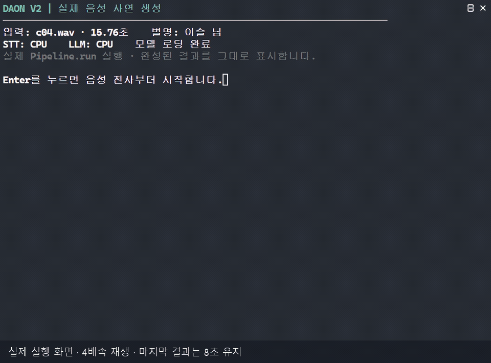
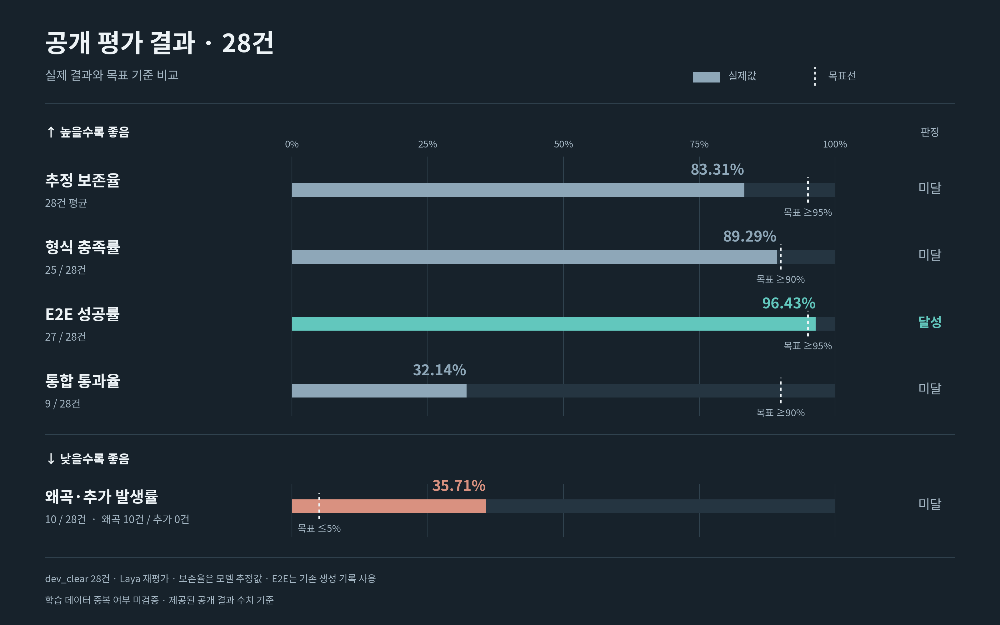

# Daon

[동작 흐름](#동작-흐름) · [환경 설정](#환경-설정) · [실행 방법](#실행-방법) · [평가 결과](#평가-결과) · [출처](#모델라이브러리-출처)

독거노인 커뮤니티를 위한 음성 사연 생성·평가 프로젝트입니다. 말로 전한 일상을 짧은 사연으로 정리하고, 다시 들을 수 있는 음성으로 만듭니다.

## 동작 흐름

[](docs/Daon_workflow.png)

KoMix V2로 음성을 전사하고, Qwen과 Kiwi로 사연을 생성·정리한 뒤 Supertonic으로 음성을 합성합니다. 정답 전사문이 있는 데이터셋에서는 Laya와 코드 검사로 내용·형식·처리시간을 평가합니다.

그림을 클릭하면 원본 크기로 볼 수 있습니다. 파일별 역할은 [구조·개발 안내](docs/ARCHITECTURE.md)를 참고하세요.

## 환경 설정

**Windows · Python 3.11 · PowerShell**에서 확인했습니다. conda, Git, [Ollama](https://ollama.com/)가 필요하며, 아래 명령은 프로젝트 루트에서 실행합니다.

### 1. Python 환경과 패키지

처음 내려받는 경우 저장소를 복제합니다.

```powershell
git clone https://github.com/PRROVE/Daon.git Daon_v2
cd Daon_v2
```

Python 환경과 ffmpeg를 준비합니다.

```powershell
conda create -n daon_v2 python=3.11 -y
$env:PYTHONUTF8 = "1"
conda install -n daon_v2 -c conda-forge "ffmpeg=7.1.0=gpl_h2585aa8_705" -y
```

PyTorch는 **실행 장치에 맞는 명령 하나**를 선택합니다. CUDA 빌드에는 호환되는 NVIDIA 드라이버가 필요합니다.

```powershell
# NVIDIA GPU — 기존 검증 환경의 CUDA 12.8 빌드
conda run -n daon_v2 pip install torch==2.11.0 --index-url https://download.pytorch.org/whl/cu128

# CPU만 사용하는 환경
conda run -n daon_v2 pip install torch==2.11.0 --index-url https://download.pytorch.org/whl/cpu
```

나머지 패키지를 설치하고 의존성을 확인합니다.

```powershell
conda run -n daon_v2 pip install -r requirements.txt
conda run -n daon_v2 pip check
```

[`requirements.txt`](requirements.txt)는 검증한 직접 의존성 버전입니다. 모든 전이 의존성을 고정한 잠금 파일은 아니며, Jetson 설치·구동은 별도 검증이 필요합니다.

### 2. 모델 준비

| 모델 | 준비 방법 | 저장 위치 |
|---|---|---|
| [KoMix V2](https://huggingface.co/seastar105/whisper-medium-komixv2) | [komixv2.pt 다운로드](https://github.com/PRROVE/Daon/releases/download/komixv2-20261105/komixv2.pt) | `models/whisper/komixv2.pt` |
| [Silero VAD](https://github.com/snakers4/silero-vad) | 아래 명령으로 v6.2.3 복제 | `models/vad/silero-vad/` |
| [Qwen3-4B-Instruct-2507](https://huggingface.co/Qwen/Qwen3-4B-Instruct-2507) | 아래 Ollama 명령으로 Q4_K_M 다운로드 | `models/ollama/` |
| [Supertonic 3](https://huggingface.co/Supertone/supertonic-3) | 최초 실행 시 자동 다운로드 | `models/supertonic/` |
| [Laya](https://github.com/NandhaKishorM/laya) | [ZIP 다운로드](https://github.com/PRROVE/Daon/releases/download/daon-v2-20261105/laya-real400-repair001.zip) 후 프로젝트 루트에 압축 해제 | `models/laya/` |

Laya는 데이터셋 평가용입니다. 사연 생성만 사용한다면 생략할 수 있습니다. 모델·라이브러리의 원본은 아래 [출처](#모델라이브러리-출처), 체크섬과 상세 설치 방법은 [설치·모델 준비 안내](docs/SETUP.md)에서 확인할 수 있습니다.

**Silero VAD** 저장소를 준비합니다.

```powershell
git clone --depth 1 --branch v6.2.3 https://github.com/snakers4/silero-vad.git models/vad/silero-vad
```

**Qwen · Ollama**는 프로젝트 루트의 별도 터미널에서 서버를 실행합니다. 이미 실행 중인 Ollama가 있다면 모델 저장 경로를 먼저 확인합니다.

```powershell
$env:OLLAMA_MODELS = (Join-Path (Get-Location) "models/ollama")
ollama serve
```

다른 터미널에서 모델을 다운로드하고 설정에 쓰는 이름으로 복사합니다.

```powershell
ollama pull qwen3:4b-instruct-2507-q4_K_M
ollama cp qwen3:4b-instruct-2507-q4_K_M qwen3:4b-instruct
```

### 3. 환경 점검

사연 생성에 필요한 패키지·모델 파일·ffmpeg·Ollama 상태를 확인합니다.

```powershell
conda run -n daon_v2 python scripts/check_env.py --generation-only
```

Laya를 포함해 데이터셋 평가까지 사용하려면 `--generation-only`를 빼고 실행합니다. `[FAIL]` 항목을 해결한 뒤 진행하세요. 점검 자체는 모델 추론이나 다운로드를 수행하지 않습니다.

기본 설정은 STT·Qwen을 CPU에서 실행합니다. 장치·모델·프롬프트 설정은 [`config/config.yaml`](config/config.yaml)에서 확인할 수 있습니다.

## 실행 방법

### 사연 생성

직접 녹음한 WAV의 경로와 닉네임을 지정합니다.

```powershell
conda run --no-capture-output -n daon_v2 python scripts/demo_story.py `
  --audio "C:\audio\recording.wav" `
  --nickname "바다 님"
```

실행 기록과 사연 텍스트는 `results/demo_날짜_시간/`에, 출력 음성은 그 안의 `audio/`에 저장합니다. `--out-dir`로 저장 위치를 바꿀 수 있습니다.

아래는 `dev_clear/c04.wav` 한 건을 실제로 실행한 화면입니다. 로컬에 해당 데이터가 준비되어 있으면 `--audio` 대신 `--sample c04`로 실행할 수 있습니다.

[](docs/Daon_demo.gif)

입력 음성 **15.76초**에서 사연 **208자**, 출력 음성 **약 28.65초**를 생성했습니다. 전체 처리시간은 **44.14초**이며, STT·LLM을 CPU에서 실행하고 모델 로딩 시간은 제외했습니다. GIF는 4배속이며 마지막 결과는 8초 동안 표시합니다.

### 데이터셋 평가

[입력 데이터 안내](examples/README.md)에 따라 음성과 원본 정답 전사문을 준비한 뒤 순서대로 실행합니다.

```powershell
# 1. 음성에서 사연과 출력 음성 생성
conda run -n daon_v2 python -m eval.run_pipeline dev_clear

# 2. 첫 단계에서 출력된 결과 폴더 이름 입력
$runId = "dev_clear_YYYYMMDD_HHMMSS"
conda run -n daon_v2 python -m eval.judge $runId

# 3. 코드 검사 및 최종 집계
conda run -n daon_v2 python -m eval.report $runId
```

결과는 `results/{run_id}/`에 저장합니다. 파일별 내용과 재평가 동작은 [평가 실행 안내](docs/EVALUATION.md), 판정 규칙과 합격 기준은 [평가지표](docs/평가지표.md)를 참고하세요.

## 평가 결과

원본 실행 `dev_clear_20261102_193946`의 사연 **28건**을 `laya-real400-repair001`로 재판정하고, 저장된 판정을 2026-11-05 집계 코드로 정리한 결과입니다. E2E는 원본 생성 실행의 시간과 음성 파일 검사 결과를 재사용했습니다.

[](docs/Daon_evaluation_28.png)

### 평가 조건

- **데이터:** `dev_clear` 28건, 샘플당 1회. 워밍업 1건 제외, 미평가 0건.
- **Laya 입력:** 원본 라벨 정답 전사문 + 닉네임 + 생성 사연. 사연만으로 판정한 결과가 아닙니다.
- **내용 판정:** 보존율은 모델 추정 점수입니다. 왜곡·추가 점수는 0.5 이상이면 발생으로 분류합니다.
- **형식:** Laya와 코드 검사를 결합합니다. 전체 규칙은 [평가지표](docs/평가지표.md)를 참고하세요.
- **E2E:** 120초 이내 생성 성공 및 정상 음성을 기준으로 하며, 평가 모델 추론 시간은 포함하지 않습니다.
- **검증 범위:** 이 28건의 학습 데이터 중복 여부는 검증하지 않았습니다. 독립된 일반화 성능으로 해석하지 않습니다.

E2E 성공률은 목표를 충족했고, 추정 보존율·왜곡/추가 발생률·형식 충족률·통합 통과율은 목표에 미달했습니다. 흐린 발음·방언의 전사 오류가 사연에 이어질 수 있으며, 단계별 원인 기여도는 아직 분리해 측정하지 않았습니다.

[한계점](docs/ISSUES.md) · [개선 계획](docs/ROADMAP.md)

### 공개 결과 파일

평가 기록은 `results/published_20261105/`에 보관합니다.

| 파일 | 내용 |
|---|---|
| [summary.json](results/published_20261105/summary.json) | 집계·합격선·실행 환경·모델 식별 정보 |
| [records.jsonl](results/published_20261105/records.jsonl) | 28건의 수치·규칙별 판정·실행 시간 |
| [judgments.jsonl](results/published_20261105/judgments.jsonl) | 28건의 Laya 점수·원시 예측·입력 해시 |
| [run.json](results/published_20261105/run.json) | 원본 생성 실행 정보와 재평가 표시 |
| [config.yaml](results/published_20261105/config.yaml) | 재판정 실행 폴더의 설정 사본 |
| [baseline_summary.json](results/published_20261105/baseline_summary.json) | 같은 사연에 대한 과거 Codex 수동 평가 요약 |

과거 기준의 사실별 보존율과 Laya 추정 보존율은 산출 방식이 다릅니다. 과거 결과는 비교 이력이며, 수치 차이를 곧바로 평가자 정확도의 차이로 해석하지 않습니다. 실제 판정에 사용한 가중치·질문·장치 정보는 `judgments.jsonl`과 `summary.json`의 메타데이터에서 확인할 수 있습니다.

공개본은 전사문·사연 본문·화자 식별자·닉네임·개인 PC 경로·음성을 제외했으며, 판정 수치는 원본 그대로입니다. 원본 입력이 없으므로 이 파일들만으로 `eval.judge`나 `eval.report`를 재실행할 수는 없습니다. 로컬 원본 결과는 별도로 보존합니다.

## 모델·라이브러리 출처

| 모델·라이브러리 | 개발자·기관 | 원본 출처 |
|:---|:---|:---:|
| **Whisper** | OpenAI | [GitHub](https://github.com/openai/whisper) |
| **KoMix V2** | seastar105 | [Hugging Face](https://huggingface.co/seastar105/whisper-medium-komixv2) |
| **Silero VAD** | Silero | [GitHub](https://github.com/snakers4/silero-vad) |
| **Qwen3-4B-Instruct-2507** | Qwen | [Hugging Face](https://huggingface.co/Qwen/Qwen3-4B-Instruct-2507) |
| **Supertonic 3** | Supertone | [Hugging Face](https://huggingface.co/Supertone/supertonic-3) · [Python SDK](https://github.com/supertone-oss-archive/supertonic-py) |
| **Laya** | NandhaKishorM | [GitHub](https://github.com/NandhaKishorM/laya) |
| **mmBERT-base** | JHU-CLSP | [Hugging Face](https://huggingface.co/jhu-clsp/mmBERT-base) |
| **Kiwi · Kiwipiepy** | bab2min | [GitHub](https://github.com/bab2min/kiwipiepy) |
| **Ollama** | Ollama | [GitHub](https://github.com/ollama/ollama) |
