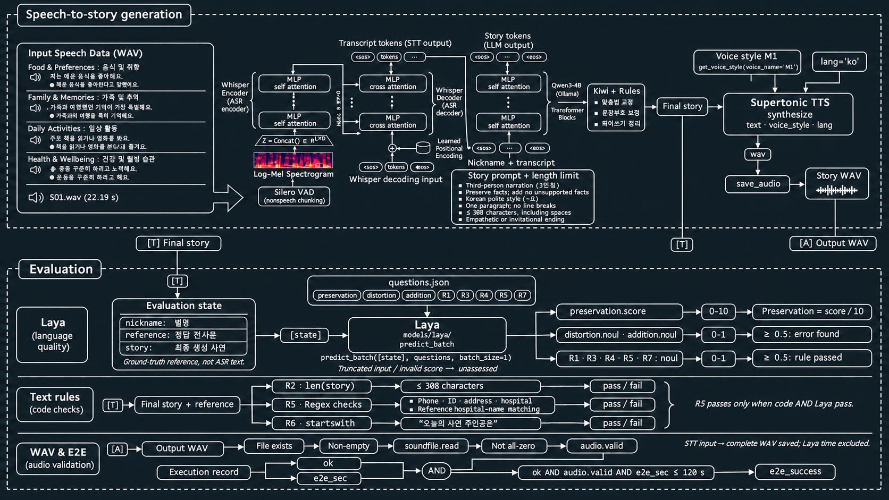

# Daon_v2

독거노인 커뮤니티용 음성 사연 생성·평가 프로젝트.

[](docs/Daon_workflow.png)

## 실제 실행 예시

[](docs/Daon_demo.gif)

`dev_clear/c04.wav` 한 건의 음성 전사부터 사연·출력 음성 생성까지 실제 실행한 화면이다. 4배속으로 재생하고 마지막 결과는 8초 동안 유지한다. GIF를 클릭하면 크게 볼 수 있다.

| 입력 음성 | 생성 사연 | 출력 음성 | E2E |
|---:|---:|---:|---:|
| 15.76초 | 208자 | 약 28.65초 | 44.14초 |

STT·LLM은 CPU에서 실행했다. 모델 로딩을 마친 뒤 측정한 값으로, E2E에는 모델 로딩 시간이 포함되지 않는다.

## 구성

주요 파일과 폴더는 다음과 같다.

```text
Daon_v2/
├── src/                        # 음성 사연 생성 파이프라인
│   ├── pipeline.py             # STT → 사연 생성 → 후처리 → TTS 연결
│   ├── stt.py                  # KoMix V2 음성 전사
│   ├── llm.py                  # Qwen 사연 생성
│   ├── formatter.py            # Kiwi 기반 후처리
│   └── tts.py                  # Supertonic 음성 합성
├── eval/                       # 데이터셋 평가
│   ├── run_pipeline.py         # 데이터셋별 생성 실행
│   ├── judge.py                # Laya 판정 실행
│   ├── laya_evaluator.py       # Laya 모델 로딩·평가
│   ├── format_check.py         # 텍스트 규칙 검사
│   └── report.py               # 평가 결과 집계
├── config/
│   └── config.yaml             # 모델·장치·프롬프트·평가 설정
├── prompts/
│   └── story.md                # 사연 생성 프롬프트
├── scripts/
│   ├── demo_story.py           # 자기 WAV·데이터셋 샘플 실행
│   └── check_env.py            # 패키지·모델 파일·Ollama 점검
├── examples/                   # manifest 형식 예제·입력 안내
├── tests/                      # 입력 처리·형식 검사·평가 집계 테스트
├── docs/                       # 구조도·데모 GIF·평가 시각화·문서
├── data/                       # 로컬 데이터셋·원본 정답 전사문
├── models/                     # 로컬 모델·가중치·토크나이저
├── results/                    # 실행별 생성 기록·판정·집계·음성
│   └── published_20261105/      # 공개 평가 결과 28건
├── .gitattributes              # 줄바꿈 고정·이미지 바이너리 처리
├── requirements.txt            # Python 패키지 의존성
└── README.md                   # 프로젝트 소개·설치·실행 안내
```

## 환경 설정

현재 확인 환경은 Windows, Python 3.11, conda 환경 `daon_v2`다. Ollama와 ffmpeg 실행 파일도 필요하다. 아래 명령은 프로젝트 루트의 PowerShell에서 실행한다.

### 1. Python 환경·패키지 설치

```powershell
conda create -n daon_v2 python=3.11 -y
$env:PYTHONUTF8 = "1"
conda install -n daon_v2 -c conda-forge "ffmpeg=7.1.0=gpl_h2585aa8_705" -y
```

PyTorch는 실행 장치에 맞는 명령 하나를 선택한다. 현재 로컬 환경은 `2.11.0+cu128`이며, CUDA 사용에는 호환되는 NVIDIA 드라이버가 필요하다.

```powershell
# NVIDIA GPU: 현재 로컬 환경과 같은 CUDA 12.8 빌드
conda run -n daon_v2 pip install torch==2.11.0 --index-url https://download.pytorch.org/whl/cu128

# CPU만 사용하는 환경
conda run -n daon_v2 pip install torch==2.11.0 --index-url https://download.pytorch.org/whl/cpu
```

나머지 패키지를 설치하고 의존성을 확인한다.

```powershell
conda run -n daon_v2 pip install -r requirements.txt
conda run -n daon_v2 pip check
```

`requirements.txt`는 현재 환경에서 확인한 직접 의존성과 Laya 호환 패키지 버전이다. 모든 전이 의존성을 고정한 환경 잠금 파일은 아니며, Jetson 설치·구동은 별도 검증이 필요하다.

### 2. 배포 모델 다운로드

Laya와 KoMix V2를 각각의 릴리즈에서 받는다. 각 릴리즈의 본문에 설치 안내와 SHA256이 있으며, 모델 파일은 하나씩 제공한다.

| 모델 | 용도 | 다운로드 | 설치 위치 |
|---|---|---|---|
| [Laya](https://github.com/PRROVE/Daon/releases/tag/daon-v2-20261105) | 사연 내용·규칙 평가 | [laya-real400-repair001.zip](https://github.com/PRROVE/Daon/releases/download/daon-v2-20261105/laya-real400-repair001.zip) | 프로젝트 루트에 압축 해제 → `models/laya/` |
| [KoMix V2](https://github.com/PRROVE/Daon/releases/tag/komixv2-20261105) | 한국어 음성 전사 | [komixv2.pt](https://github.com/PRROVE/Daon/releases/download/komixv2-20261105/komixv2.pt) | `models/whisper/komixv2.pt` |

### 3. 공개 모델 준비

#### Silero VAD

프로젝트 루트에서 로컬 저장소를 준비한다.

```powershell
git clone --depth 1 --branch v6.2.3 https://github.com/snakers4/silero-vad.git models/vad/silero-vad
```

#### Qwen · Ollama

별도 터미널에서 Ollama 서버를 실행한다. 같은 포트에 실행 중인 서버가 있다면 모델 경로 설정을 확인한다.

```powershell
$env:OLLAMA_MODELS = (Join-Path (Get-Location) "models/ollama")
ollama serve
```

서버가 실행된 상태에서 다른 터미널로 Qwen을 받는다. [공식 모델 태그](https://ollama.com/library/qwen3:4b-instruct-2507-q4_K_M)를 설정에 쓰는 이름으로 복사한다.

```powershell
ollama pull qwen3:4b-instruct-2507-q4_K_M
ollama cp qwen3:4b-instruct-2507-q4_K_M qwen3:4b-instruct
```

#### Supertonic

최초 실행 시 `models/supertonic/`으로 자동 다운로드한다.

### 4. 실행 환경 점검

모델 파일과 패키지 버전, ffmpeg, Ollama 서버·모델 등록 상태를 확인한다. 모델 추론이나 다운로드는 수행하지 않는다.

```powershell
conda run -n daon_v2 python scripts/check_env.py
```

사연 생성만 사용할 때는 `--generation-only`를 붙여 Laya 평가 모델 검사를 생략할 수 있다. `[FAIL]` 항목을 해결한 뒤 실행한다.

## 데이터 준비

자기 WAV 파일로 사연만 생성할 때는 아래 단일 샘플 명령을 사용한다. 데이터셋 평가용 파일 형식은 [manifest 예제와 준비 안내](examples/README.md)를 참고한다.

`data/{set_name}/manifest.jsonl`에는 샘플별 정보를 한 줄씩 저장한다. 현재 실행 가능한 세트는 `dev_clear`, `dev_set`, `eval_set`이다.

필수 필드는 `sample_id`, `speaker_id`, `topic`, `nickname`, `length_bucket`, `episode_id`, `duration`, `wav`, `transcript`다. `wav`와 `transcript`는 해당 세트 폴더 기준 파일 경로다.

- 생성 입력: `wav`의 음성을 STT로 전사한 텍스트.
- 평가 기준: `transcript`가 가리키는 원본 라벨 정답 텍스트. 실행 시 `ref_transcript`로 자동 저장한다.

## 생성·평가 실행

### 단일 샘플 실행

환경 설정과 모델 준비를 마친 뒤, 직접 녹음한 WAV의 경로와 닉네임을 지정한다. 실행 기록과 음성은 `results/demo_날짜_시간/`에 저장한다. `--out-dir`로 저장 위치를 바꿀 수 있다.

```powershell
conda run --no-capture-output -n daon_v2 python scripts/demo_story.py --audio "C:\audio\recording.wav" --nickname "바다 님"
```

GIF와 같은 샘플은 로컬에 `data/dev_clear/manifest.jsonl`과 해당 음성이 준비된 경우 실행할 수 있다.

```powershell
conda run --no-capture-output -n daon_v2 python scripts/demo_story.py --sample c04
```

### 데이터셋 생성·평가

```powershell
# 1. 음성에서 사연과 출력 음성 생성
conda run -n daon_v2 python -m eval.run_pipeline dev_clear

# 2. 첫 단계에서 출력된 결과 폴더 이름 입력
$runId = "dev_clear_YYYYMMDD_HHMMSS"
conda run -n daon_v2 python -m eval.judge $runId

# 3. 코드 검사 및 최종 집계
conda run -n daon_v2 python -m eval.report $runId
```

| 현재 설정 | 값 |
|---|---|
| STT 장치 | `device: cpu` |
| Qwen 장치 | `llm.num_gpu: 0` — CPU |
| Laya 장치 | `judge.device: auto` — CUDA 사용 가능 시 GPU |
| 실행 횟수 | 샘플당 1회, 워밍업 1건은 집계에서 제외 |
| E2E 제한 | 120초 |
| 사연 길이 상한 | 공백 포함 308자 |

판정 단계는 입력과 모델 설정이 같은 완료 건을 건너뛰고, 미평가·변경 건을 다시 판정한다. 기존 사연을 재평가하는 것은 음성 생성이나 E2E 시간을 다시 측정하는 작업이 아니다.

## 결과 확인

### 실행 결과 파일

결과는 `results/{run_id}/`에 저장한다.

| 파일 | 내용 |
|---|---|
| `run.json`, `config.yaml` | 실행 환경·모델·설정 기록 |
| `pipeline.jsonl`, `audio/` | 전사문·사연·정답 원문·처리시간·출력 음성 |
| `judgments.jsonl` | Laya 점수·판정·오류 기록 |
| `records.jsonl` | 사연별 내용·형식·E2E·통합 판정 |
| `summary.json` | 보존율·왜곡률·추가율·형식 충족률·E2E 성공률·통합 통과율 |

입력 누락·잘림·추론 오류는 미평가로 기록하며, 미평가가 있으면 내용 집계는 잠정 결과로 표시한다. Laya는 오류 구절에 대한 설명문을 생성하지 않는다.

### 공개 평가 결과

[](docs/Daon_evaluation_28.png)

2026-11-05 공개 집계로, `dev_clear` 28건을 Laya로 재판정한 결과다. 보존율은 모델 추정값이며, E2E는 원본 생성 실행의 시간과 음성 검사 결과를 재사용했다. 이 28건의 학습 데이터 중복 여부는 검증하지 않았다.

그림을 클릭하면 원본 크기로 볼 수 있다. [평가 조건과 상세 수치](results/published_20261105/README.md) · [집계 원본](results/published_20261105/summary.json)

### 한계점

흐린 발음과 사투리(방언)를 처리하는 과정에서 음성 전사(STT)의 오인식이나 단어 누락이 발생할 수 있다. 잘못 전사된 내용이 생성 사연에 반영되면 원문의 정보가 누락·왜곡되어, 내용 보존율과 통합 통과율이 낮아질 수 있다.

공개 평가 28건의 추정 보존율은 **83.31%**(목표 **95% 이상**), 통합 통과율은 **32.14%**(목표 **90% 이상**)로 각각 목표에 미달했다. 흐린 발음·사투리 처리의 한계는 목표 미달에 영향을 줄 수 있는 요인이지만, 이번 집계에서는 발음·방언별 영향과 생성·후처리·평가 모델의 영향을 분리해 측정하지 않았다.

## 참고 자료

### 모델 경로

| 위치 | 준비할 모델 |
|---|---|
| `models/whisper/komixv2.pt` | openai-whisper 형식으로 변환한 KoMix V2 가중치 |
| `models/vad/silero-vad/` | 현재 사용하는 Silero VAD 로컬 저장소와 모델 |
| `models/ollama/` | `qwen3:4b-instruct` — Qwen3-4B-Instruct-2507, Q4_K_M |
| `models/supertonic/` | Supertonic 모델. 코드에서 누락 시 자동 다운로드 |
| `models/laya/` | `laya-real400-repair001` 가중치·설정·토크나이저·`questions.json` |

Laya는 학습된 모델 디렉터리 전체를 함께 옮긴다. 가중치와 질문 파일은 설정의 SHA256과 일치해야 한다. 사연 프롬프트도 설정의 해시와 대조한다.

### 모델·구성요소 출처

| 구성요소 | 공개 출처 | 프로젝트에서 사용하는 형태 |
|---|---|---|
| Whisper KoMix V2 | [Hugging Face · seastar105/whisper-medium-komixv2](https://huggingface.co/seastar105/whisper-medium-komixv2), [GitHub · openai/whisper](https://github.com/openai/whisper) | 원본 모델을 openai-whisper 형식으로 변환한 `komixv2.pt` |
| Silero VAD | [GitHub · snakers4/silero-vad](https://github.com/snakers4/silero-vad), [v6.2.3 릴리스](https://github.com/snakers4/silero-vad/releases/tag/v6.2.3) | 로컬 저장소와 VAD 가중치 사용 |
| Qwen3-4B-Instruct-2507 | [Hugging Face · Qwen 원본](https://huggingface.co/Qwen/Qwen3-4B-Instruct-2507), [Ollama · Q4_K_M 배포본](https://ollama.com/library/qwen3:4b-instruct-2507-q4_K_M) | Ollama에서 Q4_K_M 가중치를 받아 `qwen3:4b-instruct` 이름으로 사용 |
| Supertonic 3 | [Hugging Face · Supertone/supertonic-3](https://huggingface.co/Supertone/supertonic-3), [GitHub · Supertonic](https://github.com/supertone-oss-archive/supertonic) | `supertonic==1.3.1`의 기본 모델. 최초 실행 시 자동 다운로드 |
| Laya | [GitHub · NandhaKishorM/laya](https://github.com/NandhaKishorM/laya), [Hugging Face · 기반 인코더 mmBERT-base](https://huggingface.co/jhu-clsp/mmBERT-base) | 프로젝트 데이터로 학습한 `laya-real400-repair001`. 실제 사용 가중치는 위 Laya 릴리즈에서 제공 |
| Kiwi 후처리 | [GitHub · bab2min/kiwipiepy](https://github.com/bab2min/kiwipiepy) | `kiwipiepy==0.24.1` 패키지를 설치해 형태소 분석에 사용 |

실제 사용 경로·설정은 [`config/config.yaml`](config/config.yaml), Python 패키지 버전은 [`requirements.txt`](requirements.txt)를 기준으로 한다.

- [평가지표](docs/평가지표.md): 판정 규칙·산식·합격 기준
- [ROADMAP](docs/ROADMAP.md): 개선 계획·개발 기능·전체 흐름
- [ISSUES](docs/ISSUES.md): 현재 남은 한계점

### 개발 확인

패키지 설치 후 모델 가중치와 원본 데이터 없이 입력 처리·형식 검사·평가 집계·프롬프트 해시를 검증한다.

```powershell
conda run -n daon_v2 python -m unittest discover -s tests -v
```
