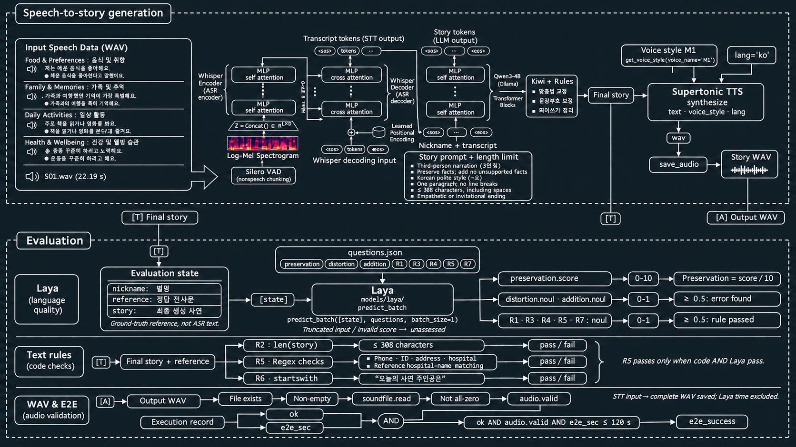

# 구조·개발 안내

[프로젝트 소개](../README.md) · [설치·모델 준비](SETUP.md) · [평가 실행](EVALUATION.md)

## 상세 동작 흐름

사연 생성은 STT → LLM → 후처리 → TTS 순서로 진행합니다. 데이터셋 평가는 생성 결과와 원본 정답 전사문을 입력받아 Laya·코드 검사 결과를 결합합니다.

[](Daon_workflow.png)

그림을 클릭하면 원본 크기로 볼 수 있습니다. 구성요소별 모델 출처와 설치 위치는 [설치·모델 준비](SETUP.md)에 모아 두었습니다.

## 폴더 구성

```text
Daon_v2/
├── src/                        # 음성 사연 생성 파이프라인
│   ├── pipeline.py             # STT → 사연 생성 → 후처리 → TTS 연결
│   ├── stt.py                  # KoMix V2 음성 전사
│   ├── llm.py                  # Qwen 사연 생성
│   ├── formatter.py            # Kiwi 기반 후처리
│   └── tts.py                  # Supertonic 음성 합성
├── eval/                       # 데이터셋 평가
│   ├── run_pipeline.py         # 데이터셋별 생성 실행
│   ├── judge.py                # Laya 판정 실행
│   ├── laya_evaluator.py       # Laya 모델 로딩·평가
│   ├── format_check.py         # 텍스트 규칙 검사
│   └── report.py               # 평가 결과 집계
├── config/
│   └── config.yaml             # 모델·장치·프롬프트·평가 설정
├── prompts/
│   └── story.md                # 사연 생성 프롬프트
├── scripts/
│   ├── demo_story.py           # 자기 WAV·데이터셋 샘플 실행
│   └── check_env.py            # 패키지·모델 파일·Ollama 점검
├── examples/                   # manifest 형식 예제·입력 안내
├── tests/                      # 입력 처리·형식 검사·평가 집계 테스트
├── docs/                       # 설치·평가·구조 안내와 시각 자료
├── data/                       # 로컬 데이터셋·원본 정답 전사문
├── models/                     # 로컬 모델·가중치·토크나이저
├── results/                    # 실행별 생성 기록·판정·집계·음성
│   └── published_20261105/      # 공개 평가 결과 28건
├── .gitattributes              # 줄바꿈 고정·이미지 바이너리 처리
├── requirements.txt            # Python 패키지 의존성
└── README.md                   # 프로젝트 소개·데모·평가 요약
```

실제 사용 경로·장치·모델·프롬프트 설정은 [`config/config.yaml`](../config/config.yaml), Python 패키지 버전은 [`requirements.txt`](../requirements.txt)를 기준으로 합니다.

## 개발 확인

패키지 설치 후 모델 가중치와 원본 데이터 없이 입력 처리·형식 검사·평가 집계·프롬프트 해시를 검증합니다. 프로젝트 루트에서 실행합니다.

```powershell
conda run -n daon_v2 python -m unittest discover -s tests -v
```

구현한 기능과 개선 계획은 [ROADMAP](ROADMAP.md), 남은 한계는 [ISSUES](ISSUES.md)를 참고하세요.
