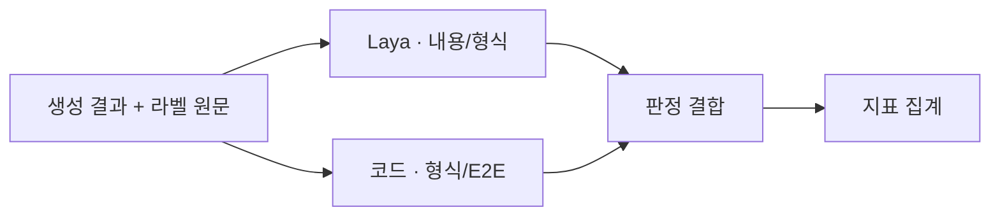

# ROADMAP

## 개발한 기능

| 기능 | 구현 내용 |
|---|---|
| 음성 전사 | Whisper KoMixV2로 한국어 전사, Silero VAD로 긴 음성 분할 |
| 사연 생성 | Qwen과 `story.md`를 사용해 전사문을 사연으로 변환 |
| 사연 후처리 | 표현·어미 정리, 도입·마무리 문구 적용 |
| 음성 합성 | Supertonic으로 최종 사연 음성 생성 |
| 실행 기록 | 데이터셋 순차 실행, 단계별 성공 여부·처리시간 기록 |
| 내용 판정 | 데이터셋의 원본 라벨 정답 전사문과 생성 사연을 Laya로 비교해 보존·왜곡·추가 판정 |
| 형식 판정 | Laya의 문맥 판정과 코드의 글자 수·도입 문구·개인정보 검사 결합 |
| E2E 판정 | 생성 성공 여부·출력 음성 정상 여부·처리시간 검사 |
| 결과 집계 | 보존율·왜곡률·추가율·형식 충족률·E2E 성공률·통합 통과율 산출 |

## 전체 흐름

### 1. 사연 생성

### 2. 데이터셋 평가

데이터셋에 제공된 원본 라벨 정답 전사문과 생성 사연을 Laya에 함께 입력해 비교한다. 코드 검사에는 사연문·원본 전사문·출력 음성·실행 기록을 사용하며, 두 판정을 합쳐 지표를 집계한다.

